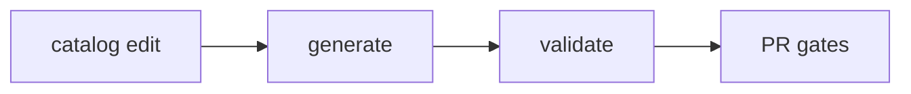

<!--
Perfect PRs get merged fast. Fill every section; delete nothing.
See docs/ARCHITECTURE.md for the flow diagrams behind this process.
-->

## Summary

<!-- One paragraph: what does this PR do and why does it matter? -->

## Motivation

<!-- What problem, gap, or request drives this? Link issues: Fixes #123 -->

## What changed

<!-- Files / skills / workflows / tooling added or fixed. Keep to one concern per PR. -->

| Area | Change |
|---|---|
| skills / workflows | <!-- e.g. added `sourdough-starter` (home-life) --> |
| catalog | <!-- e.g. entry in catalog/custom.json --> |
| generator / scripts | <!-- or "none" --> |
| docs / wiki | <!-- auto-regenerated? hand-written? --> |

## How it was tested

<!-- Prove it the way CI will. Paste commands AND their output. -->

```powershell
powershell scripts/validate.ps1 | Select-Object -Last 2
# All skills valid.
python scripts/check_frontmatter.py
# frontmatter: 576 checked, 0 bad
python mcp-server/test_smoke.py
# MCP smoke: PASS
```

Installed-skill check (proves the user path):

```powershell
powershell scripts/install.ps1 -Tool <cursor|copilot|...> -Target <temp> -Skills <name>
# installed <name> -> ...
```

New/changed skill smoke test (ask the agent, or simulate it):

```text
Prompt tried: <...>
Expected skill: <name> — loaded? yes/no, output correct? yes/no
```

## Diagrams

<!-- If the change alters a flow (factory, discovery, install, gates), update
docs/ARCHITECTURE.md and paste the relevant mermaid diagram state here.
No flow change? Write "No flow change." -->



## Checklist

- [ ] One concern per PR (one skill, one domain batch, or one infra change)
- [ ] Ran generator(s) for every catalog file I touched
- [ ] `registry.json`, `wiki/`, `SKILLS.md`, `site/skills.json` regenerated and committed
- [ ] `validate.ps1` prints PASS locally, `check_frontmatter.py` prints 0 bad
- [ ] Frontmatter is strict-YAML-safe (quoted `description`/`triggers` if they contain `: ` or ` #`)
- [ ] `name` matches folder, WHAT + WHEN description, no invented URLs, no secrets
- [ ] Docs updated if I changed a flow (`ARCHITECTURE.md`, `USAGE.md`, `INTAKE.md` as needed)
- [ ] I installed the skill the way a user would and confirmed it loads

## Follow-ups

<!-- Anything deliberately left out, with issue numbers if filed. "None" is fine. -->
