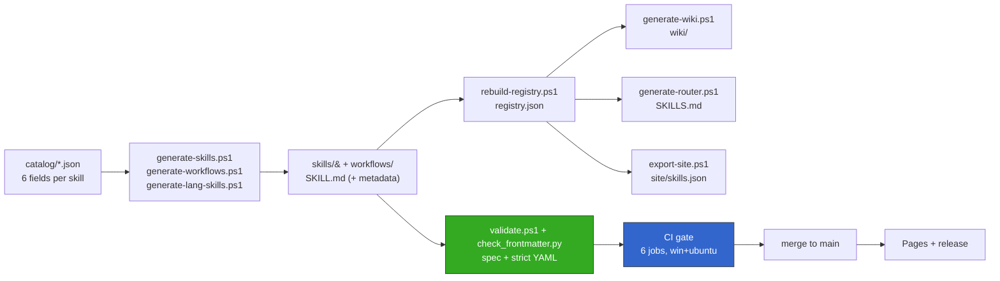
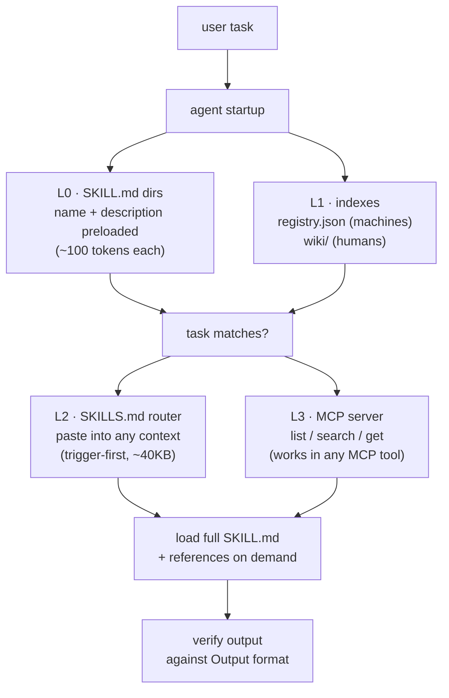
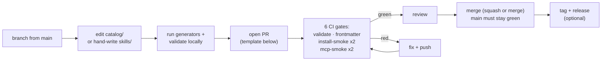

# Architecture — how hornet-swarm fits together

One repo, one rule: **facts live in small catalog JSON; everything else is
generated.** Humans edit catalog entries and hand-written skills. Machines
expand, index, verify, and publish. CI proves the two never drift apart.

## The factory pipeline (how a skill is born)



The dotted arrow that matters: **nothing downstream is hand-edited.**
`registry.json`, `wiki/`, `SKILLS.md`, and `site/skills.json` are build
artifacts. Edit the catalog, run the scripts, commit the result. CI fails the
PR if you forget a step (`git diff --exit-code`).

## Runtime discovery (how any agent finds the right skill)



Layers are independent and stackable: install 5–15 skills (L0), paste the
router so the agent knows the other ~560 exist (L2), expose MCP where the tool
supports it (L3). Any future tool works on day one if it does **any** of:
scan skill dirs, read pasted text, or speak MCP. Details: `DISCOVERY.md`.

## PR lifecycle (how changes land)



Branch protection enforces it: `main` requires all 6 checks green on an
up-to-date branch; force-pushes and deletions are blocked. No human approval
is required (solo-maintainer repo) — the gates *are* the review bar, plus a
human skim of the diff.

## What goes where (repo map)

```text
catalog/            facts: world.json, families.json, languages/*.json,
                    workflows.json, *_more.json, custom.json, imports.json
templates/          hand-write starting points (SKILL.md, skills.csv, PROPOSER-PROMPT.md)
skills/<name>/     generated + hand-written atomic capabilities
workflows/<name>/   generated plays (ordered skill chains)
registry.json       machine index (generated — do not hand-edit)
wiki/               human index, 50+ pages (generated)
SKILLS.md           trigger-first router for any agent (generated)
mcp-server/         zero-dep stdio MCP server + tests (hand-written)
site/               GitHub Pages one-pager (index.html + generated skills.json)
scripts/            factory + validators + installers (all ASCII, UTF-8 safe)
docs/               this file, PLAN, TAXONOMY, FAMILIES, FACTORY, INTAKE,
                    USAGE, DISCOVERY, RELEASE (+ root CONTRIBUTING.md)
.github/            CI (validate.yml), issue forms, PR template
```

## Design rules (the ones that survive contact with reality)

1. **Flat namespaces, rich metadata.** `skills/<name>/`, never nested by
   category — scanners expect `*/SKILL.md`. Categories live in metadata.
2. **Kinds over folders.** translate/parse/do/review/playbook is a naming
   suffix, not a directory. Workflows are skills whose job is a sequence.
3. **Frontmatter is a contract, not decoration.** Strict YAML, quoted values,
   `name` == folder. Lenient tools forgive; strict tools skip — we satisfy both.
4. **Progressive disclosure or bust.** Core <500 lines, details in `references/`,
   determinism in `scripts/`. Context is the scarcest resource.
5. **Descriptions are routing keys.** Front-load trigger words; Codex-class
   budgets truncate from the end. If a skill never fires, its description is
   wrong — never the agent.
6. **UTF-8 everywhere, ASCII in scripts.** Data files are UTF-8 no-BOM;
   PowerShell scripts stay 7-bit ASCII so PS 5.1 never mojibakes them.
7. **Generated files are never hand-edited.** If CI's sync check fails, you
   edited the wrong layer — move the change to the catalog and regenerate.
